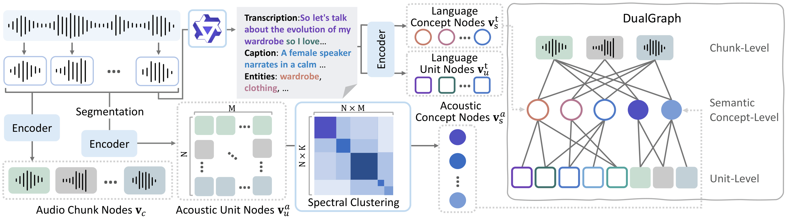

# Hierarchical Dual-Graph Retrieval for Long-form Audio Reasoning

Eunsang Lee<sup>\*</sup>, Taein Ju<sup>\*</sup>, Jiyoung Lee<sup>†</sup>

<sup>\*</sup> Equal contribution
<sup>†</sup>Corresponding author

<div>
<!--     <a href=""></a> -->
    <a href="http://mmai.ewha.ac.kr/audiohelix/"></a>
</div>

## Abstract


Large audio language models (LALMs) struggle with long-form audio reasoning, as processing entire recordings often limits to capture query-relevant content distributed across distant segments while incurring substantial computational cost.  
We introduce ***AudioHelix***, a hierarchical ***DualGraph*** framework tailored for LALMs' retrieval-augmented generation (RAG) systems. Unlike existing text-only or non-graph RAG approaches, ***AudioHelix*** connects related textual and acoustic evidence across temporally distant segments for multi-hop reasoning. Extensive experiments on TraceAV-Bench, MMAU-Pro, and AudioMarathon demonstrate that ***AudioHelix*** consistently outperforms full-audio processing and existing RAG methods.

## Requirements

### Environment

```bash
conda create -n audiohelix python=3.10
conda activate audiohelix
pip install -r requirements.txt
```

### Datasets

| Benchmark | Subset Used |
|---|---|
| [TraceAV-Bench](https://huggingface.co/datasets/TraceAV-Bench/TraceAV-Bench-Submission) | Audio-centric reasoning subset |
| [AudioMarathon](https://huggingface.co/datasets/Hezep/AudioMarathon) | All tasks except ASR |
| [MMAU-Pro](https://huggingface.co/datasets/gamma-lab-umd/MMAU-Pro) | Long and ultra-long, closed-ended |

Download each benchmark from its official source and set the corresponding environment variable to its local directory. For TraceAV-Bench, the expected structure includes `$TRACEAV_ROOT/data/*.jsonl` and `$TRACEAV_ROOT/audio/`.

### Models

| Model | Role | Source |
|---|---|---|
| Qwen2.5-Omni | textual information extraction | [Qwen2.5-Omni-7B](https://huggingface.co/Qwen/Qwen2.5-Omni-7B) |
| PE-AV | Retrieval embedding | [PE-AV-Large](https://huggingface.co/facebook/pe-av-large) |
| Qwen3-Omni | QA inference | [Qwen3-Omni-30B-A3B-Instruct](https://huggingface.co/Qwen/Qwen3-Omni-30B-A3B-Instruct) |
| Voxtral | QA inference | [Voxtral-Mini-3B-2507](https://huggingface.co/mistralai/Voxtral-Mini-3B-2507) |
| Audio Flamingo 3 | QA inference | [Audio Flamingo 3](https://huggingface.co/nvidia/audio-flamingo-3-hf) |

All models except Qwen3-Omni are downloaded from Hugging Face on first use. 
Qwen3-Omni has no Hub default: set `QWEN3_OMNI_MODEL_PATH` to a local copy or to the Hub repo (`Qwen/Qwen3-Omni-30B-A3B-Instruct`) before running it.


## Configuration

- Configuration files 
    - Benchmark-specific defaults : `eval/{benchmark_name}/setup/config.py`
    - Shared model and runtime settings : `audiohelix/config.py`

Stage-specific settings can also be passed through the CLI:

```bash
python -m audiohelix.run qa --bench {benchmark_name} --model {model_name} --retrieval-top-k {k}
```

Run `--help` on any stage to see available options.

## Evaluation

Before running evaluation, set the environment variable for each benchmark to
the local dataset directory:

```bash
export TRACEAV_ROOT=/path/to/TraceAV-Bench
export AUDIOMARATHON_ROOT=/path/to/AudioMarathon
export MMAU_PRO_ROOT=/path/to/MMAU-Pro
```

Then, run evaluation with the desired QA backbone:

```bash
python eval/{benchmark_name}/inference.py --model {model_name}
```

❗For **MMAU-Pro**, score `pred.parquet` separately using `eval/mmau_pro/scoring/score_mmau_pro.py` in an environment with `transformers==4.51`.

### Results

- Results directory : `eval/{benchmark_name}/data/results/{model_name}/{timestamp}/`
   - Files
        - `results.json` : Per-question answers, correctness, and retrieved evidence (not used for MMAU-Pro)
        - `prompt.txt` : Inference prompt
        - `summary.json` : Scores and run configuration (MMAU-Pro : written by the separate scoring pass)
        - `run_qa.log` : Execution log

   - AudioMarathon-specific file
        - `run_qa_snapshot.py` : Snapshot of the runner script

   - MMAU-Pro-specific files
        - `pred.jsonl` : Per-question predictions and errors
        - `pred.parquet` : Predictions and metadata added to the original test data 
        - `meta.json` : Run metadata
        - `pred_closed_detail.jsonl` : Per-question details from the separate scoring pass

## Build the DualGraph index

Build the ***DualGraph*** index for one benchmark at a time.

```bash
python -m audiohelix.run manifest --bench {benchmark_name}
python -m audiohelix.run index --bench {benchmark_name}
```


To run caption generation separately:

```bash
python -m audiohelix.run index --bench {benchmark_name} --stage captions
```

This stage can be resumed; existing artifacts are reused unless `--force` is specified.

Artifacts are stored under `eval/{benchmark_name}/data/`, including `chunks/`, `captions/`, `units/`, `embed_cache/`, and `index/`.

Example index paths:

- `eval/traceav/data/index/k10_s5/{video_id}/`
- `eval/audiomarathon/data/index/{suite}/c30-k10_s6/{item_id}/`

### ID Conventions

| Item | Format | Example |
|---|---|---|
| Chunk | `{item}_ch{idx:04d}` | `video1_ch0000` |
| Audio unit | `{chunk}_a{seq:02d}` | `video1_ch0000_a00` |
| Transcription unit | `{chunk}_t{i}` | — |
| Caption unit | `{chunk}_c{i}` | — |
| Audio-cluster concept | `cpt{seq:04d}` | `cpt0000` |

Chunk indices are global and zero-based. Text concepts use their own text as the ID.


## Inference on Custom Audio

Run inference on your own audio file. The index and answers are stored under `--workdir`, which defaults to `./audiohelix_run/{audio_name}/`.

```bash
python inference.py --audio {audio_path} -q "{question}"
```


## Acknowledgement
This project references the implementation of [LinearRAG](https://github.com/DEEP-PolyU/LinearRAG).

We thank the authors for making their code publicly available.

## License

This project is licensed under the GPL-3.0 license. See [LICENSE](LICENSE).